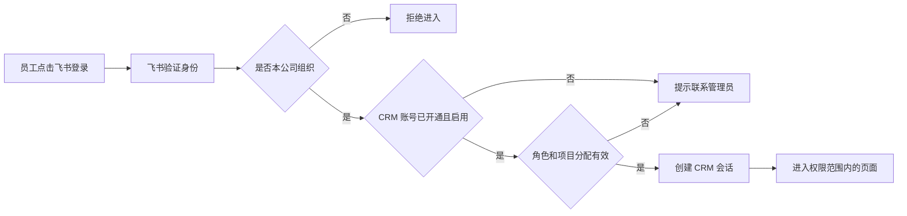
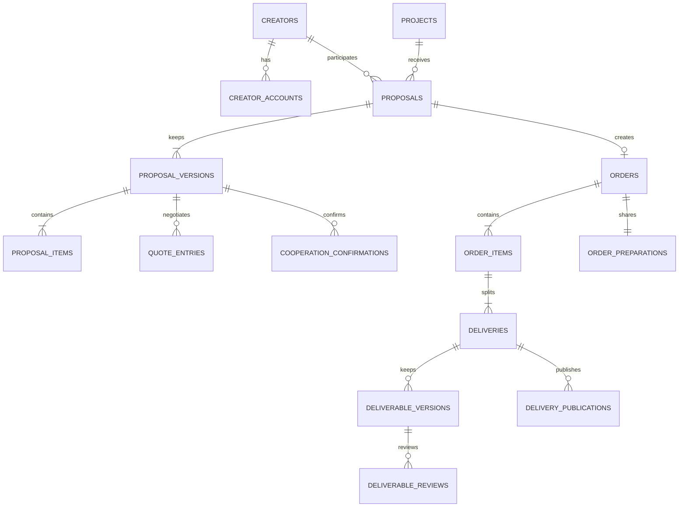

# SOLBRIDGE CRM 后端建表与飞书登录设计 草案

日期：2026 年 10 月 14 日。

飞书在线文档：[SOLBRIDGE CRM 后端建表与飞书登录设计 草案](https://jcnvoy8nz41t.feishu.cn/wiki/Ed7fwreUTisCU9knOK0ctSw3nbd)，位于“我的文档库”。

本方案用于把当前浏览器内的 CRM 原型转为公司员工共同使用的系统。登录、数据共享和重复合作规则已经确认；表结构和接口仍按设计稿评审。本次保存设计文档，不创建数据库、不申请飞书权限、不修改 CRM 业务页面。

## 已确认的登录条件

| 条件 | 规则 |
|---|---|
| 登录方式 | 首期仅飞书登录，无账号密码注册、短信登录或备用登录 |
| 组织范围 | 仅本公司飞书组织内的员工 |
| 开通方式 | CRM 管理员提前开通员工，分配角色和项目后允许进入 |
| 未开通员工 | 飞书认证成功后仍不能进入 CRM，提示联系管理员；不自动创建已启用账号 |
| 登录时长 | 单次会话最长 8 小时，连续 2 小时无操作后重新登录 |
| 停用 | CRM 账号停用时立即撤销其会话，后续请求拒绝访问 |
| 飞书配置 | 由用户联系公司飞书管理员创建、配置并发布企业自建应用 |

超级管理员不要求分配具体项目。PM 和运营必须具有有效项目分配，才可启用业务访问。PM 的分配可来自项目默认 PM 或项目地区 PM 规则。

飞书支持网页授权登录、扫码登录及工作台内的免登录接入。首期设计采用“使用飞书登录”统一入口，工作台作为同一套身份和权限检查的入口。接入需要企业自建应用、网页入口和已登记的 OAuth 回调地址；发布按公司应用管理规则执行。[飞书官方接入说明](https://www.feishu.cn/content/7317091221654224898)、[自建应用发布与审核](https://www.feishu.cn/hc/zh-CN/articles/374230668270-%E8%87%AA%E5%BB%BA%E5%BA%94%E7%94%A8%E5%8F%91%E7%89%88%E5%AE%A1%E6%A0%B8%E6%8C%87%E5%8D%97)。

## 登录与权限检查

后端接收飞书授权结果后获取用户身份，核对公司，再查 CRM 员工记录。飞书只承担身份验证；是否为 PM、运营或超级管理员，以及负责哪个项目、地区和订单，由 CRM 数据库决定。现有模拟账号下拉框不能作为正式权限来源。

首期申请登录所需的身份信息；若管理员开通界面需要从公司通讯录选员工，再配置限定范围的通讯录只读权限。完成登录不要求申请飞书云文档读写或消息发送权限。

正式系统使用内部员工 ID 关联业务记录，另存飞书身份映射。优先使用公司身份范围内的 `tenant_key` 和 `user_id` 做唯一映射；使用 `open_id` 时必须同时限定公司和应用。不按姓名、昵称或邮箱自动匹配 AJ、seven、Tia、Jennie。飞书的用户 ID 在组织、应用等范围内有不同含义，应用更换或员工重新加入时需要核实身份关联。[飞书用户身份说明](https://open.feishu.cn/document/platform-overveiw/basic-concepts/user-identity-introduction/introduction)。

| 登录结果 | 员工看到的提示 | 后端处理 |
|---|---|---|
| 不属于本公司 | 请使用公司飞书账号登录 | 不签发 CRM 会话 |
| 员工未开通 | 账号尚未开通，请联系 CRM 管理员 | 不创建已启用账号，不返回业务数据 |
| 账号停用或离职 | 账号已停用，请联系管理员 | 拒绝登录并撤销已有会话 |
| 角色或项目未分配 | 尚未分配访问权限，请联系管理员 | 不允许进入业务模块 |
| 授权取消或验证失败 | 飞书登录未完成，请重试 | 保留安全的返回页面，允许重新登录 |
| 登录过期 | 登录已过期，请重新使用飞书登录 | 不提交未授权操作，前端保留当前输入供重新登录后核对 |

### 会话设计

- 后端生成随机会话凭证，通过 `HttpOnly`、`Secure`、`SameSite=Lax` Cookie 保存；数据库只保存凭证哈希。业务数据不再以 `localStorage` 为共享存储。
- 每次业务请求检查员工是否启用、会话是否有效及当前角色和项目权限。不能信任前端传入的员工 ID、PM 身份或可见范围。
- `expires_at` 固定为签发后 8 小时；空闲期限根据最后一次有效用户活动计算 2 小时。后台轮询不延长登录时间。
- 退出、停用或调整权限时撤销相应会话；权限变更后重新登录。不需要为了保留 CRM 会话而长期存储飞书用户访问令牌。
- OAuth 登录保存短期随机 `state` 并校验回调；授权码只在后端交换。应用密钥放服务端配置，安全返回路径只允许本站地址。
- 飞书侧离职或移出应用可用范围，与撤销 CRM 已有会话是两个步骤。首期离职操作需要管理员停用 CRM；若要自动同步，另配置通讯录变更事件及定期对账，并落实所需权限和延迟要求。

飞书认证接入依据：[获取授权码](https://open.feishu.cn/document/authentication-management/access-token/obtain-oauth-code)、[获取用户访问凭证](https://open.feishu.cn/document/authentication-management/access-token/get-user-access-token)、[获取用户信息](https://open.feishu.cn/document/server-docs/authentication-management/login-state-management/get)。

## 角色和业务范围

| 能力 | 超级管理员 | PM | 运营 |
|---|---|---|---|
| 员工开通、停用和角色分配 | 管理 | 不管理 | 不管理 |
| 项目默认 PM 和地区 PM 分工 | 管理 | 使用分配结果 | 使用分配结果 |
| 现有业务交接 | 管理并留记录 | 接收或交出被分配业务 | 接收或交出被分配业务 |
| 提报、订单和视频记录 | 公司范围 | 仅分配给自己的业务 | 仅本人当前负责的记录 |
| 达人基础资料 | 公司共享库 | 公司共享库 | 公司共享库 |
| 首次提报审核 | 可按现有规则处理 | 审核本人负责业务 | 提交或重新提报 |
| 报价和客户确认 | 可按现有规则处理 | 对客报价、客户还价、新方案和客户结果 | 达人回价、达人确认及订单创建 |
| 稿件 | 可按现有规则处理 | 本人负责业务的初审、退回、送客户、登记客户结果 | 本人负责业务的草稿、提交和重提 |
| 发布和验收 | 可按现有规则处理 | 本人负责业务的客户验收 | 本人负责业务的发布资料 |

角色只有超级管理员、PM、运营三类。AJ、seven、Tia、Jennie 是员工姓名，不是写死的权限类型。不同项目可以分配不同 PM；是否有操作权限还取决于当前业务状态。首期不增加新的业务审批步骤。

公司飞书管理员不会自动成为 CRM 超级管理员。正式页面的模拟账号选择器改为当前登录员工和退出入口；模拟视角只保留在隔离的开发测试环境。

登录权限、读数据权限、操作权限分别检查。例如 Tia 可以登录，也加入 Tripo，并不因此获得审核 Jennie 记录或操作任意视频的权限。接口按记录所属公司、项目、当前运营和负责 PM 过滤，直接修改 URL 或请求中的记录 ID 不能扩大权限。

### 已确认的数据共享与重复合作

达人基础库在公司内共享：Tia、Jennie 可以复用同一达人和平台账号。共享读取不自动扩大编辑或删除权限，资料维护继续按现有规则判断。

运营只能查看本人当前负责的提报、合作订单和视频；加入同一项目不会获得另一位运营的合作价格、确认结果、稿件和审核记录。列表、搜索、详情、统计和导出使用同一范围。PM 仍只查看分配给自己的业务，超级管理员可查看公司范围。

同一达人在同一项目可以再次创建独立合作。新提报使用新编号，并保存独立方案、报价、确认、订单及视频，不覆盖原合作。提示安排在正式提交时，项目切换或打开表单不自动弹窗。用户确认创建新提报后，后端再检查权限、当前 PM 路由及请求是否已经提交。

已有合作提示遵守数据权限：可展示“该达人在此项目已有合作”的存在信息；本人无权查看的旧合作不返回详情、金额、稿件或审核记录，也不提供打开他人记录的入口。重复合作确认只说明此次创建新的独立合作，不授权访问旧合作。

数据库不对“公司、项目、达人”组合设置禁止再次合作的唯一约束。重复点击或网络重试由请求幂等机制拦截；明确创建另一笔合作使用新的提交请求。每份提报仍最多生成一个订单。

## 数据库总体结构

建议用关系型数据库承载正式业务，PostgreSQL 可作为默认方案；若公司已有统一数据库规范，实施前按公司规范调整。提报、订单和视频独立存储，方案及稿件按版本保留。普通字段采用明确类型，JSON 只用于不可变快照、视图配置和导入原始记录，不把全部业务塞进一个 JSON 字段。

主键使用内部 UUID。业务表统一保存 `company_id`、创建时间和修改时间，操作人员使用员工外键。对可修改的主记录增加 `row_version`，避免两个员工同时保存时覆盖对方修改。时间在数据库按 UTC 保存，页面按时区显示。

### 员工和登录表

| 表名 | 主要字段 | 关联与约束 |
|---|---|---|
| `companies` 公司 | `id`、名称、`feishu_tenant_key`、启用状态 | 飞书组织标识唯一；首期只允许本公司 |
| `employees` 员工 | `id`、`company_id`、姓名、角色、账号状态、`auth_version`、开通人、停用时间、最后登录时间 | 角色限定三类；停用保留历史外键；启用前检查分配 |
| `employee_feishu_identities` 飞书身份 | 员工 ID、公司组织标识、应用 ID、`user_id`、`open_id`、可选 `union_id` | 按身份实际作用域唯一；一个飞书身份不能绑定两个 CRM 员工 |
| `login_sessions` 登录会话 | 员工 ID、凭证哈希、签发时的 `auth_version`、创建时间、最后活动、绝对到期时间、撤销时间 | 凭证哈希唯一；不存明文会话凭证 |
| `oauth_login_attempts` 登录请求 | `state` 哈希、回调地址、安全返回路径、到期时间、已消费时间 | 短期有效、一次消费，不保存到业务审计详情中 |

### 项目和人员分配表

| 表名 | 主要字段 | 关联与约束 |
|---|---|---|
| `projects` 项目 | 项目编号、名称、客户、需求、默认 PM、状态 | Tripo、Flora 是项目数据；默认 PM 必须是本公司启用的 PM |
| `project_members` 项目成员 | 项目 ID、员工 ID、成员职责、加入时间、移出时间 | 同一项目和员工的有效成员关系唯一；历史关系保留 |
| `project_pm_routes` 地区 PM 路由 | 项目 ID、目标地区代码、PM 员工 ID、启用状态、修改人和时间 | 同一项目和地区最多一条有效规则；使用规范地区代码 |
| `assignment_changes` 人员交接 | 原运营、原 PM、新运营、新 PM、范围、涉及记录、原因、执行人和时间 | 原负责人及历史操作人员不能被覆盖；与业务更新一并提交 |

### 达人表

| 表名 | 主要字段 | 关联与约束 |
|---|---|---|
| `creators` 达人 | 达人编号、名称、国家、语言、类型、联系邮箱、备注、状态 | 邮箱不作为达人唯一身份；不同达人可能共用机构邮箱 |
| `creator_accounts` 平台账号 | 达人 ID、平台、平台稳定 ID、标准化 Handle、主页链接、粉丝、均播、指标更新时间 | 同公司同平台稳定 ID 唯一；无稳定 ID 时按规范账号查重，空值不混作重复 |
| `creator_initiators` 达人发起人 | 达人 ID、员工 ID、关联时间 | 同一达人和发起人关系唯一，支持共享和交接后保留原发起人 |

### 提报和报价表

| 表名 | 主要字段 | 关联与约束 |
|---|---|---|
| `proposals` 提报 | 提报编号、达人 ID、项目 ID、目标地区、原提报人、负责运营、负责 PM、当前方案版本、流程状态、当前进度进入时间、结束原因、重复合作确认人和时间 | 负责 PM 保存实际分配结果；同达人同项目可有多份独立提报；提报编号在公司内唯一 |
| `proposal_versions` 方案版本 | 提报 ID、版本号、币种、整包合作价、权益、备注、修改原因、修改人和时间 | 同一提报版本号唯一；已形成的历史版本不覆盖 |
| `proposal_items` 方案内容 | 方案版本 ID、合作平台、视频类型、数量、分发平台、排序 | 数量为正整数；多个平台内容独立保存 |
| `quote_entries` 报价记录 | 提报 ID、方案版本 ID、轮次、报价类型、金额、币种、备注、操作人、时间、关联对客报价 ID | 类型区分初始报价、对客报价、客户还价、达人回价；对客报价最多三轮 |
| `cooperation_confirmations` 合作确认 | 提报 ID、方案版本 ID、确认方、确认金额、对应报价、确认结果、备注、登记人和时间 | 区分达人与客户确认；关联同一最终方案，不能仅凭状态文字判断已同意 |

报价轮次属于提报，合作条件属于方案版本。一轮报价、客户还价、达人回价必须能相互关联；新方案不能把旧版本确认直接当作新版本确认。对客报价唯一轮次的约束只针对对客报价，不禁止第三轮之后登记最终客户结果。

初始报价和每次回价保留原记录。确认成交后，当前合作价以最终确认关联的有效达人回价为准，订单复制该成交金额；价格更新不覆盖历史报价，也不自动增加新的审批环节。

### 订单和单条视频表

| 表名 | 主要字段 | 关联与约束 |
|---|---|---|
| `orders` 合作订单 | 订单编号、提报 ID、最终版本 ID、双方确认 ID、当前运营和 PM、地区、整包合作价、整包对客价、币种、合作内容快照、订单状态、创建人和时间 | 一份提报最多创建一个订单；创建时校验双方确认及当前版本；快照不随后续资料编辑变化 |
| `order_items` 订单内容 | 订单 ID、来源方案内容 ID、平台、视频类型、数量、权益和分发平台快照 | 保存已成交内容；每一内容项可拆出多条视频 |
| `order_preparations` 共用准备资料 | 订单 ID、平台注册邮箱、邀请码、邀请链接、现有准备备注和完成标记、各项填写人和时间 | 每个订单一条；同订单视频共用，不与达人联系邮箱混用 |
| `deliveries` 单条视频 | 交付编号、订单 ID、订单内容 ID、视频序号、视频名称、合作平台和类型、单条合作价、单条对客价、币种、流程状态、进度进入时间、计划日期、验收时间 | 订单内容内视频序号唯一；视频进度独立；同订单所有分摊合计等于整包金额 |

单条 Margin 用单条对客价减单条合作价计算；整包 Margin 同理。首期沿用 CNY、USD、EUR、GBP，金额以最小货币单位整数或精确小数保存，不用浮点数。缺少价格与价格为零分别处理，允许保留负 Margin。不同币种分别统计。

### 稿件和发布表

| 表名 | 主要字段 | 关联与约束 |
|---|---|---|
| `deliverable_drafts` 未提交草稿 | 视频 ID、稿件类型、编辑人、链接、说明、保存时间、`row_version` | 草稿和已提交版本分开；草稿不触发审核，也不提升交付状态 |
| `deliverable_versions` 稿件版本 | 视频 ID、脚本或成片类型、稿次、链接、说明、提交人和时间、当前审核结果 | 同视频同类型稿次唯一；重提新增版本，保留被退回稿 |
| `deliverable_reviews` 审核记录 | 稿件版本 ID、审核来源、动作、结果、意见、操作人、时间 | 意见必须关联具体稿件版本；PM 初审与客户结果分别记录 |
| `delivery_publications` 发布记录 | 视频 ID、发布平台、计划和实际日期、发布链接、分发链接、验收结果、意见、登记人和时间 | 一条视频可在多个平台发布，分发不会额外拆成另一条视频 |

### 审计和辅助表

| 表名 | 用途 |
|---|---|
| `audit_events` | 追加保存业务对象、动作、操作者 ID、操作者姓名快照、发生时间、修改摘要、请求 ID及适用的交接原因；不包含 Cookie、密钥和飞书令牌 |
| `saved_views` | 员工、模块、视图名称和筛选配置；刷新位置等临时信息继续按标签页保留 |
| `work_tasks` | 保存现有未完成提醒的业务对象、负责人、到期时间、状态和交接历史；保留存量数据，不增加新的跟进页签 |
| `idempotency_records` | 防止创建订单、提交稿件、执行交接等因重试产生重复记录；请求键和请求内容摘要一并校验 |
| `import_batches` | 记录浏览器数据导入来源、执行人、数量、校验结果、导入时间和状态 |
| `legacy_import_records` | 保留导入原始数据与新记录映射，包括旧备注、历史跟进和已移除界面的字段，不重新增加跟进记录页签 |

数据库唯一约束、外键和数值约束用于保护关联和基础数据；跨多行的分摊、确认和完成判断放在事务内检查，不写成读取其他表的普通 `CHECK` 约束。PostgreSQL 官方说明了这些约束的适用范围，以及行锁在并发更新中的作用。[约束说明](https://www.postgresql.org/docs/current/ddl-constraints.html)、[并发锁说明](https://www.postgresql.org/docs/current/explicit-locking.html)。

## 必须落到后端的已确认业务规则

页面阶段与进度继续沿用现有映射，细分审核动作由后端工作流状态和审核记录表达。

| 模块 | 页面阶段 | 页面具体进度 |
|---|---|---|
| 提报 | 提报审核 | 待 PM 审核 |
| 提报 | 待议价 | 待运营议价、待 PM 反馈、议价待客户确认 |
| 提报 | 合作确认 | 待达人确认 |
| 提报 | 合作确认完成 | 合作确认完成、已创建订单 |
| 提报 | 已结束 | 不予提报、客户不合作、达人不合作 |
| 视频 | 待补充邮箱 | 待补充邮箱 |
| 视频 | 脚本阶段 | 脚本制作中、脚本待审核、脚本修改中 |
| 视频 | 视频阶段 | 视频制作中、视频待审核、视频修改中 |
| 视频 | 发布阶段 | 待发布、已发布 |

视频发布后是否已经验收完成，通过独立验收结果表达，保留当前页面“已发布”的展示映射；历史取消记录与完成记录分开保存。

1. PM 按“项目加目标地区”确定。例如 Tripo 美国的提报由 AJ 处理，Tia、Jennie 的提报使用同一规则；地区规则未命中时使用项目默认 PM。选中的 PM 或默认 PM 已停用、未配置时提示管理员处理，不能给无权限账号发任务。
2. 负责 PM 覆盖首次提报、后续报价、脚本、成片和验收。路由修改只影响新提报，已有提报、订单和视频必须通过明确的交接操作修改负责人。
3. 第三轮对客报价仍未达成一致时继续等待最终结果，不自动结束，不允许第四轮对客报价。第三轮之后仍可按确认规则登记达人回价和最终结果。
4. 客户提出新方案时由 PM 录入，运营再向达人确认；达人接受后由 PM 登记该版方案客户同意，运营再创建订单。确认均指向同一版最终内容。
5. 确认成交后用适用最终方案的最新有效达人回价更新整包合作价，再计算 Margin 和视频分摊；没有后续回价时保留该最终方案双方已确认的合作价，不取其他版本的金额。
6. 同一订单拆出的每条视频独立保存稿件、审核和发布进度。所有视频完成后订单显示已完成。视频取消或结束时，是否按完成处理尚未确认，不能默认为验收完成。
7. 平台注册邮箱为订单共用资料，按现有规则作为新交付进入脚本的前提；邀请码和邀请链接不阻塞脚本制作。历史已进入后续阶段的视频不因补录准备资料倒退。
8. 合作条件、已确认金额和所属订单内容保留快照；后续编辑达人资料、项目名称或 PM 路由不改写历史成交记录。
9. 提报和视频的“最近更新”与“当前进度进入时间”分开；普通保存不重置停留时间，同一对外展示进度内的审核子步骤不重置该计时。
10. 界面继续使用提报整包抽屉和单条视频抽屉，操作成功原位更新，不新增跟进记录、跨页面跳转、付款审批或新的业务审批状态。

这些是后端实施的目标规则，其中地区未命中回退、成交合作价更新、订单全部视频完成后的汇总等此前仅在脑图确认，需要实施时与现有原型差异逐项核对。

## 多员工同时操作

创建订单时，在同一事务中锁定提报、核对版本和双方确认、读取成交价、创建订单及所有视频、分摊金额、更新提报状态并记录审计。一份提报的订单唯一约束与请求幂等检查共同防止重复创建。

审核、重提和交接提交时校验 `row_version`。例如 AJ 正在审核第一稿，但 Tia 已提交新版本，旧页面的审核不能应用到新稿。冲突时返回“记录已更新，请核对最新内容”，保留本地输入；不能覆盖另一位员工的操作。

每条视频验收通过时锁定所属订单并检查全部视频，再决定是否更新订单完成。这样两条视频同时完成时不会出现各自只看到旧汇总的情况。

## 人员调动和离职

| 情况 | 管理员操作 | 数据处理 |
|---|---|---|
| 新员工加入 | 选择经核实的本公司飞书员工，分配角色和项目，再启用 CRM | 使用新内部员工 ID，不按姓名接替别人 |
| PM 地区调整 | 修改项目地区规则 | 影响新提报；已有工作不自动改负责人 |
| PM 或运营交接已有工作 | 预览未完成记录、选择范围、指定接收人、填写原因并确认 | 事务更新提报及关联订单、视频和未完成任务；保留过去的报价和审核人 |
| 角色调整 | 核对未完成任务后调整角色及项目关系 | 撤销原会话，重新登录使用新权限；不删除员工记录 |
| 紧急停用或离职 | 立即停用 CRM 并撤销全部会话，再完成业务交接 | 可以先阻断登录再交接；历史责任与操作记录保留 |
| 员工改名或修改邮箱 | 更新显示资料 | 内部员工 ID 和已核实飞书身份不因显示资料变化而替换 |

需要保留已完成业务的历史负责人；只有明确选中的存量工作进行交接，不能把全部历史记录一并改成新 PM。第一位 CRM 超级管理员必须由部署负责人按经核实的飞书身份预置，不采用“第一个登录的人自动成为超管”。

## 后端接口范围

以下为接口设计范围，尚未实现。前端可按现有抽屉继续使用，业务提交改由服务器验证和落库。

现有根目录 Next.js 服务是名单清洗与飞书写入工具，使用共享访问密码。CRM 不能把该密码或应用身份访问凭证当作员工登录。可沿用公司认可的服务端技术，但需要独立的 CRM 会话和权限检查；仅登录发起、回调等必要入口公开，业务接口仍受保护。

| 接口组 | 需要支持的操作 |
|---|---|
| 登录 | 发起飞书登录、接收回调、获取当前员工与权限、退出 |
| 员工管理 | 开通、启用、停用、分配角色和项目、查询权限变更记录 |
| 项目 | 项目列表和详情、成员管理、默认 PM、地区路由、交接预览和执行 |
| 达人 | 查询、创建和修改资料、管理多平台账号和发起人关系 |
| 提报 | 新提报、首次审核、重提、方案版本、报价和还价、双方确认、结束合作 |
| 订单 | 原子创建、查询成交快照、准备资料、完成汇总 |
| 视频 | 交付查询、保存草稿、提交下一稿、审核和客户结果、发布、验收 |
| 辅助 | 筛选视图、审计查询、经确认的数据导入 |

不能提供供前端任意修改状态、负责 PM 或已确认金额的通用业务更新入口。业务动作逐项校验权限与允许的状态变化；批量查询、导出及统计也使用同样的数据范围。

## 数据迁移和验收

正式数据从已核对的浏览器导出或公司现有数据源导入。测试服务器和演示种子数据不进入正式库。若员工各自浏览器已有不同副本，先列出冲突并确认来源；不能用最后导入的一份覆盖整库。

员工映射必须由管理员核实飞书身份。现有模拟 `pm1`、`pm2`、`a`、`b` 等仅作为迁移来源标识。保留达人、提报、订单和交付的显示编号，以及旧版本、原提报人和历史审核资料。缺少的历史时间或确认记录不补造成已经发生的审批。

| 验收场景 | 预期结果 |
|---|---|
| 本公司已开通、角色和项目有效的员工 | 可以飞书登录并看到正确范围 |
| 外部组织、未开通、停用或未分配的账号 | 不能进入业务数据 |
| Tia 和 Jennie 查看达人库 | 可读取同一份公司达人基础资料，不重复创建平台账号 |
| Tia 查询 Jennie 负责的合作或视频 | 列表、详情、统计和导出均不暴露他人业务；直接请求记录 ID 也被拒绝 |
| 同达人同项目再次提报 | 正式提交时提示已有合作，确认后生成独立新提报，原记录及订单不变 |
| 已有合作属于另一位运营 | 提示存在合作，不返回对方的价格、稿件或审核信息 |
| 再次提报确认后重复点击或重试 | 同一提交请求只创建一条新提报；再次主动创建独立合作可使用新请求 |
| 超过 8 小时或空闲 2 小时 | 重新登录；后台轮询不能延长会话 |
| 登录后员工被停用或权限变化 | 原会话后续请求失效 |
| Tia 和 Jennie 提报 Tripo 美国 | 都分配 AJ，跨项目分配不串联 |
| 未命中地区、无有效默认 PM | 前者回退默认 PM；后者明确阻止提交并提示处理 |
| 第三轮没有成交 | 保留等待状态，不出现第四轮对客报价 |
| 新方案与旧客户确认不一致 | 不能凭旧确认创建新方案订单 |
| 最新回价成交后创建两条视频 | 整包和单条金额一致，分摊合计准确 |
| 重试订单创建或稿件提交 | 同请求不产生重复订单、视频或稿件 |
| 两人同时修改或审核旧版本 | 提示冲突，保留输入，不覆盖新数据 |
| 单条视频退回或完成 | 不修改同订单其他视频；全部验收完成后订单完成 |
| 人员交接 | 接收人得到选中未完成工作的权限，历史操作人保持不变 |
| 恢复数据库备份 | 业务记录和关联可恢复，会话与密钥按安全配置处理 |

## 待确认和接入资料

| 项目 | 当前状态 |
|---|---|
| 视频取消后如何影响订单完成 | 等待业务规则确认，先保留为不同于完成的状态 |
| 飞书离职是否需要自动停用 CRM | 待确认是否首期接入；人工停用即时撤会话已纳入 |
| 第一位 CRM 超级管理员 | 由公司指定并核实飞书身份 |
| 正式服务器、HTTPS 域名和数据库 | 由公司 IT 确认部署位置；本机 8765 不是员工共享地址 |
| 飞书应用资料 | 公司组织标识、应用 ID、应用配置负责人、可用员工范围及回调地址；应用密钥只配置到服务端，不在聊天或文档里粘贴 |
| 备份 | 上线前确定频率、保留期限与恢复负责人，并完成一次恢复验证 |

建议实施顺序：按已确认规则定稿字段与数据库约束 → 配置飞书应用和正式环境 → 实现后端登录与权限 → 逐模块接入业务接口 → 经确认迁移数据 → 员工小范围验收 → 正式使用。
